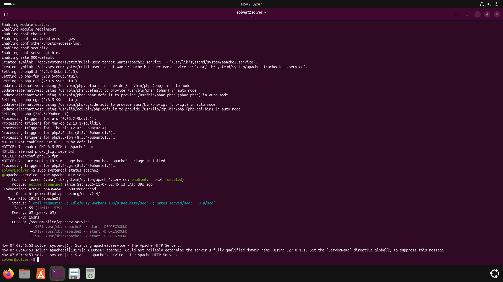
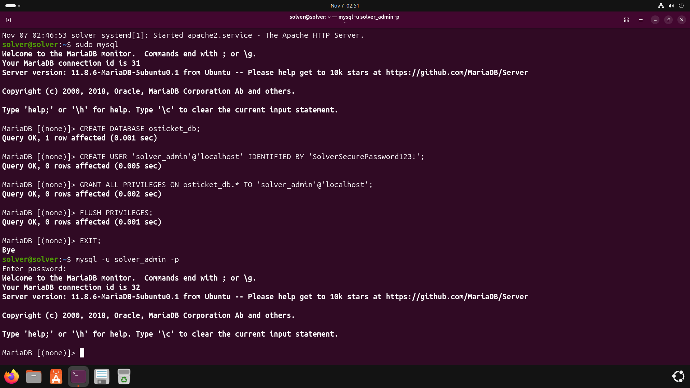
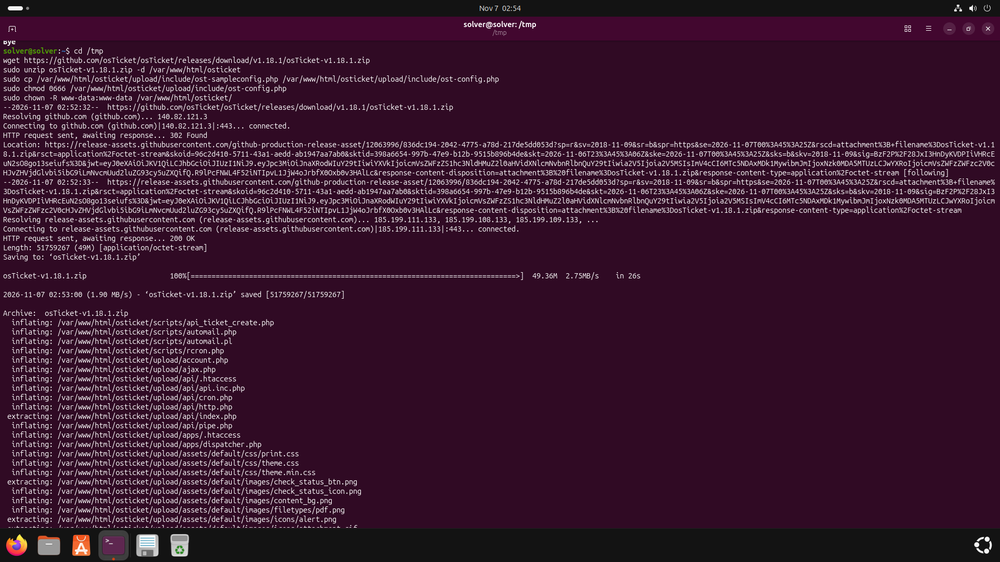
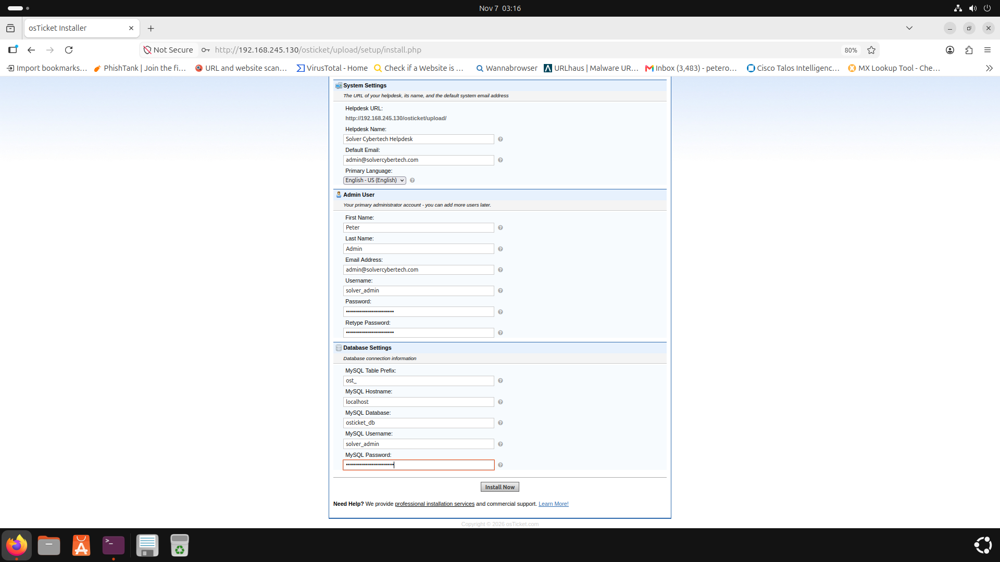
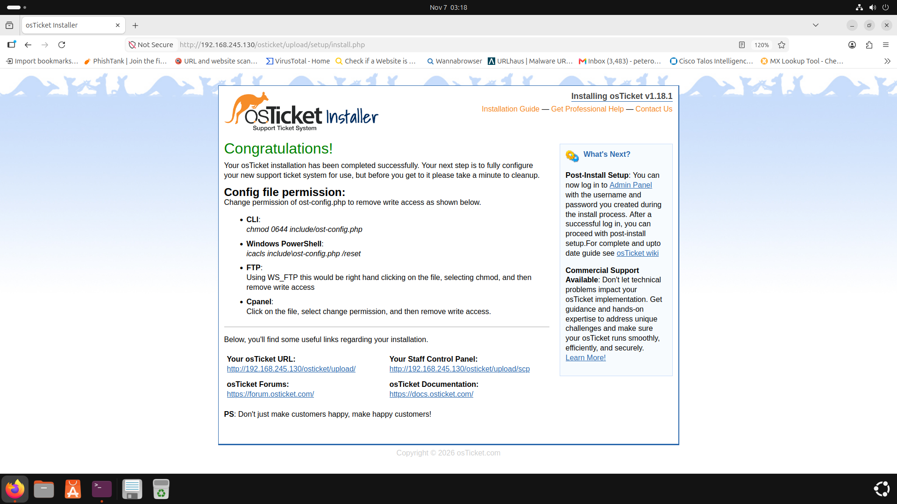
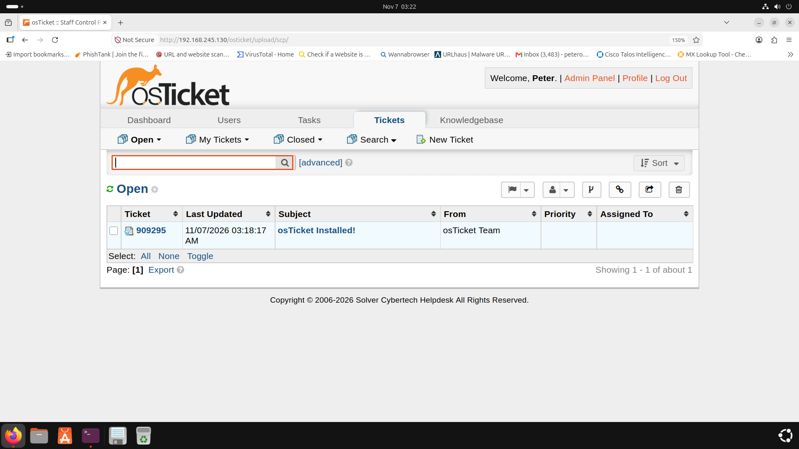
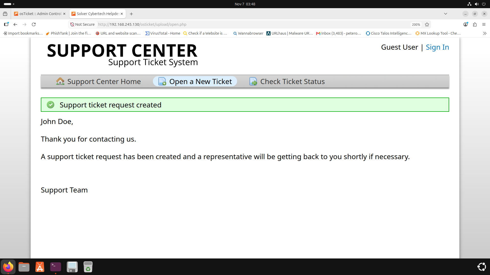
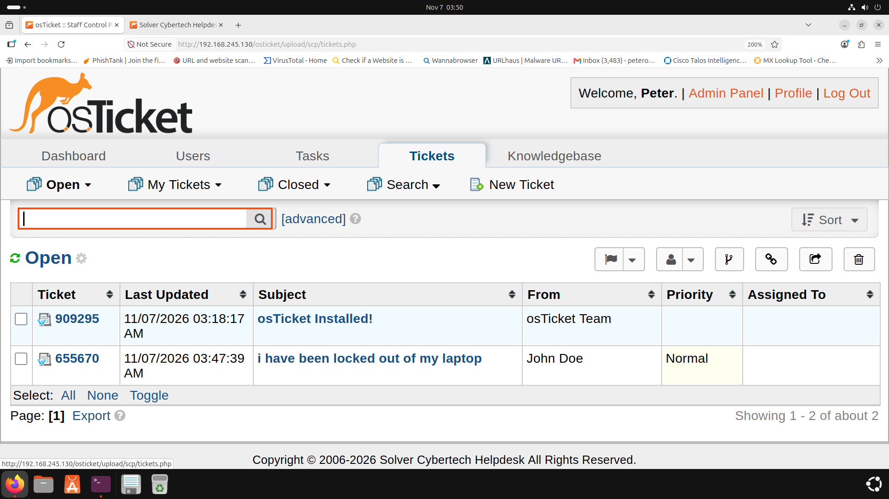
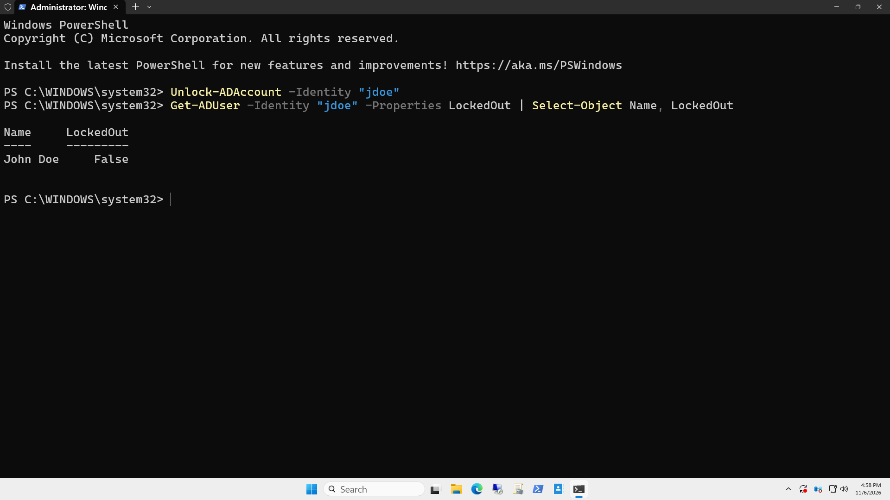
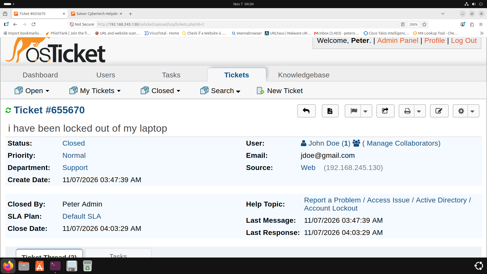

# 🛠️ Enterprise Helpdesk & Active Directory Remediation Lab
**Author:** Peter Okonkwo | **Brand:** Solver Cybertech  
**GitHub:** [solver113](https://github.com/solver113)  
**LinkedIn:** [Peter Okonkwo](https://www.linkedin.com/in/peter-okonkwo-3b6610230)

---

##  CORE COMPETENCY HIGHLIGHTED
 **Key Practical Skills Demonstrated:**
 * ⚙️ **Configured osTicket from Scratch:** Complete Web GUI configuration, system parameter setup, email conflict resolution, and Help Topic mapping (`Active Directory / Account Lockout`).
*    🎫 **End-to-End Ticket Lifecycle:** Managed real-world issue workflow from end-user ticket creation through agent queue triage to ticket resolution and closure.
* 🔐 **Active Directory PowerShell Remediation:** Resolved user lockouts on Windows Server 2025 using `Unlock-ADAccount` and verified status via PowerShell.

---

## 📌 Project Overview
This portfolio project demonstrates an end-to-end enterprise IT Helpdesk deployment and Active Directory (AD) user account remediation workflow. The lab simulates a real-world tier-1/tier-2 IT support environment where an end-user experiences an Active Directory account lockout and submits a support ticket through osTicket.

---

## 🏗️ Architecture & Lab Environment
- **Virtualization:** VMware Workstation
- **Ticketing Server:** Ubuntu Server running Apache, MariaDB, and PHP (LAMP Stack) with osTicket v1.18.1
- **Domain Controller:** Windows Server 2025 running Active Directory Domain Services (AD DS) & PowerShell
- **Network Scope:** Private Internal Virtual Network (`192.168.245.0/24`)

---

## 📷 Full Workflow & Deployment Documentation

### Phase 1: Infrastructure Deployment & Database Setup
- **LAMP Stack Installation:** Installed Apache web server, MariaDB database server, and required PHP core extensions on Ubuntu.
  

- **Database Provisioning:** Provisioned dedicated MySQL database `osticket_db` and assigned administrative user privileges.
  

- **File Deployment:** Extracted osTicket release binaries into `/var/www/html/osticket` and set Apache permissions (`www-data`).
  

---

### Phase 2: System Configuration & osTicket Hardening ⚙️
- **Web Installer & Helpdesk Configuration:** Configured system parameters, admin credentials (`solver_admin`), and connected to `osticket_db`.
  

- **Installation Completion:** Confirmed system installation and database table initialization.
  

- **Staff Control Panel Configuration:** Secured configuration file permissions (`0644`), removed setup directory, and logged into the active Agent Dashboard.
  

---

### Phase 3: Ticket Lifecycle & Active Directory Remediation 🎫
- **Step 1 — End-User Ticket Submission:** Simulated user *John Doe* submitting an issue under the custom Help Topic **Active Directory / Account Lockout**.
  

- **Step 2 — Agent Queue Triage:** Logged into the Staff Control Panel to inspect, assign, and triage the open lockout ticket.
  

- **Step 3 — PowerShell AD Remediation (Windows Server 2025):** Executed administrative PowerShell remediation on the Domain Controller:
  ```powershell
  Unlock-ADAccount -Identity "jdoe"
  Get-ADUser -Identity "jdoe" -Properties LockedOut | Select-Object Name, LockedOut
Verification Output: LockedOut : False



* **Step 4 — Ticket Resolution & Closure:**  Responded to user with root-cause analysis, verified logon, and marked ticket status as Closed.



# 🔒 Security Best Practices Implemented
* Enforced strict read-only configuration file permissions (chmod 0644).

*Completely removed installer /setup/ directory post-installation.

*Followed principle of least privilege for database account access (solver_admin).

* **Author:** Peter Okonkwo

Lead Engineer & Founder, Solver Cybertech

LinkedIn: https://www.linkedin.com/in/peter-okonkwo-3b6610230

  
  
